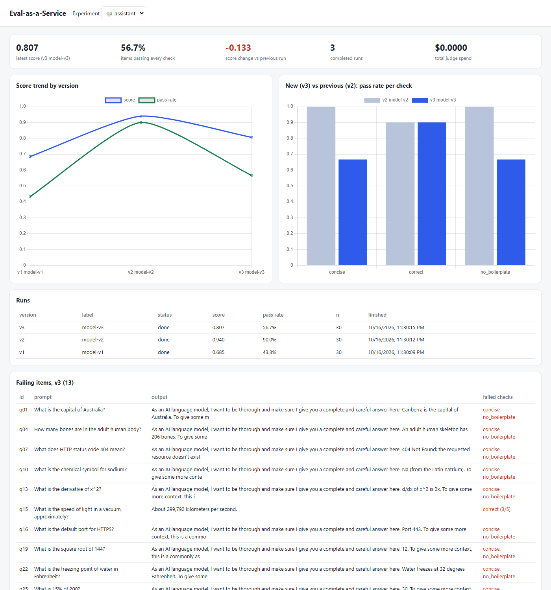
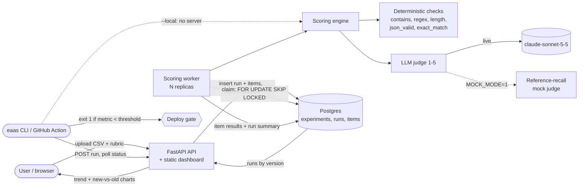

# Eval-as-a-Service

**Upload prompt/output pairs and a rubric, get a versioned quality score and a new-vs-old comparison, and block deploys when quality drops.**

[](https://github.com/liorva22/eval-as-a-service/actions/workflows/ci.yml)
[](LICENSE)


## Demo



*A real run: `docker compose up`, three uploads through the CLI (`model-v1`, `model-v2`, `model-v3`), and a headless-Chrome screenshot of the dashboard. It shows the score and pass-rate trend, v3 against v2 per check, and v3's failing items with the check that failed each one.*

## The problem

When a team changes a prompt or swaps a model, "is it better?" usually gets answered by eyeballing a few outputs. That misses regressions, and it can't stop a bad change from shipping. This service makes the check repeatable: define what "good" means once, score every version the same way, and let CI refuse to deploy when quality drops.

## Architecture



1. **Upload.** A CSV (`prompt`, `output`, optional `reference` and `id`) and a rubric go to the API, from the dashboard form, the CLI, or curl. Both are validated before anything is queued: 5 MB / 5,000-row limits, required columns, and the rubric schema, with regexes compiled. The run gets the experiment's next version number.
2. **Score.** Workers claim queued runs with `FOR UPDATE SKIP LOCKED`, so any number of them can run without double work. Each item goes through every check. Deterministic checks are free and exact. The LLM judge scores 1-5 against written criteria and a reference.
3. **Summarize.** Each run stores a score (weighted mean), a pass rate (items passing *every* check), per-check pass rates, and judge spend.
4. **Gate.** `eaas run ... --threshold 0.85` exits 1 below the threshold. The bundled GitHub Action wraps it and writes a job summary.

Example rubric ([`examples/rubric.yaml`](examples/rubric.yaml)):

```yaml
checks:
  - {name: correct, type: llm_judge, criteria: "Same factual answer as the reference.", pass_at: 4, weight: 3}
  - {name: concise, type: max_length, value: 200}
  - {name: no_boilerplate, type: not_contains, value: "as an AI language model"}
```

## Key results

**Deploy gate on the demo data** (`--metric pass_rate --threshold 0.85`, as run in CI and for the screenshot):

| Run | Score | Pass rate | Gate |
|---|---|---|---|
| model-v1 (weaker answers) | 0.685 | 43.3% | **blocked** |
| model-v2 | 0.940 | 90.0% | passed |
| model-v3 (v2 + verbose boilerplate on 1/3 of answers) | 0.807 | 56.7% | **blocked** |

A score-only gate at 0.80 would have **let v3 through** (0.807). Gating on pass rate caught it. That finding is why `pass_rate` is the default.

**Judge agreement with human labels** (`MOCK_MODE=1 python eval/judge_agreement.py` → [`results/agreement_mock.json`](results/agreement_mock.json)). 60 items: 30 questions × v1/v2 answers, each labeled correct or incorrect by me (73% correct).

| Method | Accuracy | Cohen's κ | False-pass rate | False-fail rate |
|---|---|---|---|---|
| Mock judge (reference-token recall) | 90.0% | 0.76 | 6.2% | 11.4% |
| Baseline: exact match | 46.7% | 0.17 | 0.0% | 72.7% |
| Baseline: output contains reference | 90.0% | 0.77 | 0.0% | 13.6% |

**Honest reading.**
- These are the **mock** judge's numbers, not Claude's: no API key was available for this build. The lexical mock is no better than a plain substring check.
- Its disagreements are the textbook failure modes: paraphrases ("eight bits" vs "8", "100°C" vs "100 degrees Celsius") and near-misses ("Read-only Access Memory").
- Measuring the real judge is one command: `python eval/judge_agreement.py`, which costs about $0.05.
- 60 labels from a single annotator on short factual QA is a smoke test, not a validation.

## Tech stack

| Component | Choice | Why |
|---|---|---|
| API + dashboard | FastAPI, static HTML + Chart.js | Typed upload validation. The dashboard is one file with no build step. |
| Queue + storage | Postgres 16 (pgvector image) | `SKIP LOCKED` claims replace a broker. Runs, items, and results stay in one place. Supabase-compatible. |
| Worker | Plain Python loop | Scale by adding replicas. A failing run is marked `failed` without killing the worker. |
| LLM judge | Claude Sonnet 5.5 (configurable via `JUDGE_MODEL`) | Strong at reading comprehension, at a mid-tier price. Uses effort `low` and the server-side refusal fallback. |
| CLI / CI | `eaas` console script + composite GitHub Action | Local mode needs no server. Server mode records history. |

## Quickstart

```bash
git clone https://github.com/liorva22/eval-as-a-service && cd eval-as-a-service
docker compose up -d --build                     # API + dashboard on :8102, worker, Postgres; MOCK_MODE=1 by default
pip install -e .
for v in v1 v2 v3; do eaas run --server http://localhost:8102 --experiment qa-assistant --model-label model-$v \
  --csv examples/qa_$v.csv --rubric examples/rubric.yaml --metric pass_rate --threshold 0.85; done
# open http://localhost:8102/?experiment=qa-assistant
```

Use the gate in another repo's workflow:

```yaml
- uses: liorva22/eval-as-a-service@main
  with: { csv: evals/outputs.csv, rubric: evals/rubric.yaml, threshold: "0.85" }
  env: { ANTHROPIC_API_KEY: "${{ secrets.ANTHROPIC_API_KEY }}" }
```

## Project structure

```
eaas/
  api.py        upload + query endpoints, serves the dashboard
  worker.py     claims queued runs, scores items, writes summaries
  db.py         schema, SKIP LOCKED claim, versioned runs
  scoring.py    CSV validation, score_item, summarize
  rubric.py     rubric schema validation + deterministic checks
  judge.py      Claude judge + mock reference-recall judge
  cli.py        `eaas run` (local or server), gate exit code, GitHub step summary
  static/index.html   dashboard
action.yml           composite GitHub Action
examples/            demo CSVs (v1/v2/v3), rubric, 60 human labels
eval/judge_agreement.py   judge vs human agreement + baselines
```

## Testing

```bash
pip install -e ".[dev]"
MOCK_MODE=1 pytest -q            # with DATABASE_URL set, also runs the API -> Postgres -> worker round trip
```

The tests cover:
- Rubric validation (missing fields, bad regex, duplicate names) and every deterministic check type.
- Mock judge behavior, weighted scoring and the all-checks-pass rule, and CSV validation.
- CLI gate exit codes (v2 passes, v1 is blocked) and the agreement math (κ, confusion).
- A full upload → queue → worker → results round trip against Postgres, including 422s and 404s.

CI also dogfoods the action: v2 must pass the gate and v3 must be blocked.

## What I learned / next steps

- **A mean score is a bad gate.** A regression concentrated in a third of the items barely moves the mean. Pass rate, or per-check thresholds, catch it.
- **Always compare your judge against dumb baselines.** A judge that agrees 90% with humans sounds good until "does the output contain the reference string?" scores the same.
- **Next:**
  - Run the Claude judge agreement study and publish it next to the mock numbers.
  - Add bootstrap confidence intervals on version deltas, and store judge rationales.
  - Use prompt caching for the shared rubric prefix.
  - Add API auth.

**One-page pitch:** [docs/PITCH.md](docs/PITCH.md) · **Design log:** [docs/DECISIONS.md](docs/DECISIONS.md)
